# package-document-search

Hybrid document search for TalkingDB: one query is answered by meaning (vector search in Milvus) and by exact words (keyword search in [SQLite](https://www.sqlite.org/about.html) FTS5 with BM25 ranking), and the two result lists are combined into one ranked list.


| Start here | Go deeper |
| :--- | :--- |
| [Key terms](#key-terms) | [Architecture: storage and ranking](docs/architecture.md) |
| [Where this fits](#where-this-fits) | [Usage and examples: create, train, search](docs/usage-and-examples.md) |
| [Quickstart](#quickstart) | [Troubleshooting](docs/troubleshooting.md) |
| [What this repo is not](#what-this-repo-is-not) | [Client (direct or API mode)](#client) |

All pages: [docs/](docs/README.md).

This package is domain agnostic TalkingDB infrastructure: it has no built in concept of "products", "ecommerce" or any other domain. Domain vocabulary belongs to the `module-*` repositories that consume it.

## Key terms

| Term | Meaning |
| :--- | :--- |
| **Vector** ([embedding](https://en.wikipedia.org/wiki/Word_embedding)) | A list of numbers that stands for the meaning of a piece of text. Texts with similar meaning get similar numbers, so "refund timeline" can find "money back in 7 days" |
| **Keyword search** | Finding documents that contain the query's words. Here it uses [SQLite FTS5](https://www.sqlite.org/fts5.html), ranked with [BM25](https://en.wikipedia.org/wiki/Okapi_BM25) |
| **Hybrid search** | Running both and combining the scores, so a result can be right by meaning, by exact words, or both |
| **Namespace** | One separate search index, usually one per tenant or use case |
| **Partition** | A slice of a namespace, so you can search or delete part of it |

## Where this fits

<picture>
  <source media="(prefers-color-scheme: dark)" srcset="docs/images/where-package-document-search-fits-dark.svg">
  
</picture>

<sub>Diagram source: [where-package-document-search-fits.mmd](docs/diagrams/where-package-document-search-fits.mmd). Edit it and re-render with the steps in [docs/diagrams](docs/diagrams/README.md).</sub>

In words: crawlers and modules hand documents and queries to this service, which keeps meaning in Milvus and words in SQLite, and needs OpenAI to turn text into vectors.

## Quickstart

You need Python 3.12 or 3.13, [Poetry](https://python-poetry.org/docs/#installation), the three `base-tdb-*` repositories checked out next to this one, an `OPENAI_API_KEY` for embeddings, and either a Milvus server or a [Milvus Lite](https://milvus.io/docs/milvus_lite.md) file.

```bash
make sync MODE=git      # or MODE=local for editable base-tdb-* checkouts
poetry install
make test               # runs against an embedded Milvus Lite, no server needed
make local              # API on http://localhost:8094, Swagger at /docs
```

> [!TIP]
> For local work without a Milvus server, set `DS_MILVUS_URI` to a Milvus Lite file path such as `./milvus_demo.db`. Production uses `MILVUS_HOST` and `MILVUS_PORT`.

## How results are ranked

The ranking rule is short and deterministic ([`services/search/ranking.py`](talkingdb_ds/services/search/ranking.py)):

| Result found by | Score |
| :--- | :--- |
| Vector search only | 2.0 |
| Vector and keyword search | 2.0 plus keyword strength (0 to 1) |
| Keyword search only | 1.0 plus keyword strength (0 to 1) |

Keyword strength is the BM25 rank rescaled within this result set, so the best keyword hit gets 1 and the weakest gets 0. Anything scoring 1.0 or less is dropped. A worked example is in [docs/usage-and-examples.md](docs/usage-and-examples.md#see-the-ranking-on-real-numbers).

## Client

`talkingdb_ds.client.DSClient` gives callers one interface that works two ways, chosen by `CLIENT_MODE` (default `direct`):

- **Direct mode** calls the same service functions the API routers call, in process.
- **API mode** calls a deployed package-document-search service over HTTP. Set `CLIENT_MODE=api` and `DS_HOST` to its base URL.

## What this repo is not

- **Not explainable by itself.** A vector match cannot say why it matched. TalkingDB modules use this search as a fallback, after the [knowledge graph](https://en.wikipedia.org/wiki/Knowledge_graph) path in [package-parse-tree](https://github.com/TalkingDB/package-parse-tree) has had its chance.
- **Not a crawler.** Getting pages in is [package-search-trainer](https://github.com/TalkingDB/package-search-trainer).
- **Not offline.** Training and vector search call OpenAI for embeddings.
- **Not a document parser.** It indexes text you give it; reading PDFs and DOCX files is [package-content-elementizer](https://github.com/TalkingDB/package-content-elementizer).

## Related repositories

| Repository | Relationship |
| :--- | :--- |
| [package-search-trainer](https://github.com/TalkingDB/package-search-trainer) | Crawls pages and trains them into this service |
| [module-ecommerce-ai](https://github.com/TalkingDB/module-ecommerce-ai) | Falls back to this search when a query does not resolve in the knowledge graph |
| [base-tdb-clients](https://github.com/TalkingDB/base-tdb-clients) | SQLite connection for the keyword store |

## Further reading

- [Milvus documentation](https://milvus.io/docs) and [Milvus Lite](https://milvus.io/docs/milvus_lite.md)
- [SQLite FTS5](https://www.sqlite.org/fts5.html) and [Okapi BM25](https://en.wikipedia.org/wiki/Okapi_BM25)
- [OpenAI embeddings guide](https://platform.openai.com/docs/guides/embeddings)

## License

> [!NOTE]
> This repository does not have a LICENSE file yet. Most TalkingDB repositories are licensed under [AGPL-3.0](https://www.gnu.org/licenses/agpl-3.0.html); until a LICENSE file is added here, no license is granted by this README.
