# Architecture

[Docs home](README.md) › Architecture

Where package-document-search keeps data, how a search runs, and the settings it reads. For setup, start at the [README](../README.md).

## Storage

| Store | Holds | Code | Settings |
| :--- | :--- | :--- | :--- |
| Milvus collection per namespace | Your fields plus one [embedding](https://en.wikipedia.org/wiki/Word_embedding) field, optionally split into partitions | [`services/vector/store.py`](../talkingdb_ds/services/vector/store.py) | `DS_MILVUS_URI` (wins if set, for Milvus Lite or a URI), else `MILVUS_HOST` (default `milvus-db`) and `MILVUS_PORT` (default `19530`) |
| [SQLite](https://www.sqlite.org/about.html) FTS5 tables | The text fields you train for keyword search | [`services/keyword/store.py`](../talkingdb_ds/services/keyword/store.py) | `SEARCH_DB` (default `data/search.db`) |
| SQLite config table | Per namespace switches: vector on or off, keyword on or off, output fields | [`services/config/store.py`](../talkingdb_ds/services/config/store.py) | same `SEARCH_DB` |
| OpenAI | Nothing stored; turns text into vectors with `text-embedding-ada-002` | [`services/vector/embeddings.py`](../talkingdb_ds/services/vector/embeddings.py) | `OPENAI_API_KEY`, read by the OpenAI client |

## One search, step by step

<picture>
  <source media="(prefers-color-scheme: dark)" srcset="images/how-a-hybrid-search-runs-dark.svg">
  
</picture>

Diagram source: [how-a-hybrid-search-runs.mmd](diagrams/how-a-hybrid-search-runs.mmd). Edit it and re-render with the steps in [docs/diagrams](diagrams/README.md).

In words: vector search runs when it is switched on and the namespace exists; keyword search is added only when you name a keyword field; the combined list keeps results scoring above 1 and puts the best first. Code: [`services/search/orchestrator.py`](../talkingdb_ds/services/search/orchestrator.py).

## The scoring rule

[`services/search/ranking.py`](../talkingdb_ds/services/search/ranking.py):

1. Keyword hits get a **strength** between 0 and 1: `(worst rank minus this rank) / (worst rank minus best rank)`. [BM25](https://en.wikipedia.org/wiki/Okapi_BM25) ranks in FTS5 are negative, and more negative is better. If every hit has the same rank, all get 1.
2. A vector hit scores 2.0. If the same document is also a keyword hit, its strength is added.
3. A keyword only hit scores 1.0 plus its strength.
4. Results scoring 1.0 or less are dropped, so the weakest keyword only hit in each search never shows.

> [!NOTE]
> Vector hits are not ordered by similarity inside this rule; every vector hit starts at 2.0. Weak vector matches are cut before ranking: only hits with similarity above `threshold` are kept, and `threshold` defaults to 0.70 ([`vector/store.py`](../talkingdb_ds/services/vector/store.py)).

## API map

| Group | Routes |
| :--- | :--- |
| Knowledge base | `GET /api/namespaces`, `POST` and `DELETE /api/namespaces/{namespace}`, partitions under `/api/namespaces/{namespace}/partitions`, `POST /api/namespaces/{namespace}/index` |
| Training | `POST /api/namespaces/{namespace}/train/vectors`, `POST /api/namespaces/{namespace}/train/keywords` |
| Search | `POST /api/namespaces/{namespace}/search`, `GET` and `PUT /api/namespaces/{namespace}/config` |

## Dependencies

As of 25 November 2026 this repository pins `base-tdb-models` at `6ad6e83`, `base-tdb-clients` at `29abea2` and `base-tdb-helpers` at `d7c891b`. It is pinned by [package-search-trainer](https://github.com/TalkingDB/package-search-trainer) and [module-ecommerce-ai](https://github.com/TalkingDB/module-ecommerce-ai) at `e571768`, the current head of `main`.

---

**Related:** [Troubleshooting](troubleshooting.md) · [Usage and examples](usage-and-examples.md) · [README](../README.md)
