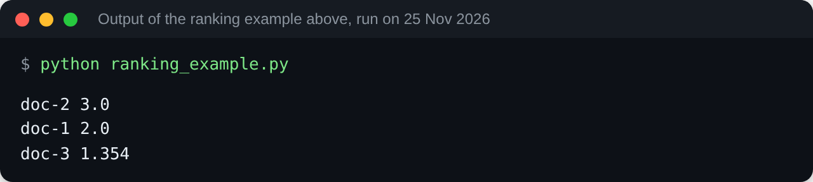

# Usage and examples

[Docs home](README.md) › Usage and examples

Create a namespace, train documents for both kinds of search, and query it.

```bash
DS=http://localhost:8094
NS=support
```

## 1. Create a namespace with a field schema

The schema is a JSON string listing the Milvus fields. One field is the primary key and one holds the vector. `text-embedding-ada-002` vectors have 1536 dimensions.

```bash
curl -s -X POST "$DS/api/namespaces/$NS" \
  -H "Content-Type: application/json" \
  -d '{"description": "Support articles",
       "field_schema": "[{\"name\": \"id\", \"dtype\": \"string\", \"is_primary\": true, \"max_length\": 64}, {\"name\": \"embedding\", \"dtype\": \"vector\", \"dim\": 1536}, {\"name\": \"title\", \"dtype\": \"string\", \"max_length\": 256}]"}'
```

The same schema shape, with a small `dim` of 8, is used by the tests in [`tests/unit/services/search/test_orchestrator.py`](../tests/unit/services/search/test_orchestrator.py).

## 2. Train vectors

`data` is **column by column**, in the schema's field order. `vector_index` says which column holds the texts to embed; the service replaces that column with vectors from OpenAI before inserting.

```bash
curl -s -X POST "$DS/api/namespaces/$NS/train/vectors" \
  -H "Content-Type: application/json" \
  -d '{"data": [["a1", "a2"],
                ["How long do refunds take?", "Can I exchange a damaged item?"],
                ["Refunds", "Exchanges"]],
       "vector_index": 1}'
```

Empty strings in the embedded column are rejected before any call to OpenAI.

## 3. Train keywords

```bash
curl -s -X POST "$DS/api/namespaces/$NS/train/keywords" \
  -H "Content-Type: application/json" \
  -d '{"documents": [{"id": "a1", "title": "Refunds", "body": "Refunds reach your account within 7 days."},
                     {"id": "a2", "title": "Exchanges", "body": "Damaged items can be exchanged within 10 days."}],
       "id_field": "id"}'
```

Use the same `id` values as the vector data, so a document found both ways is combined into one result.

## 4. Search

```bash
curl -s -X POST "$DS/api/namespaces/$NS/search" \
  -H "Content-Type: application/json" \
  -d '{"query": "money back timeline", "vector_field": "embedding", "keyword_field": "body", "limit": 10}'
```

| Field | Meaning |
| :--- | :--- |
| `vector_field` | The Milvus field that holds [embeddings](https://en.wikipedia.org/wiki/Word_embedding) |
| `keyword_field` | The text field to search with FTS5. Leave it out for vector search only |
| `partition` | Search one partition only |
| `threshold` | Keep only vector matches whose similarity is above this. Defaults to 0.70 when not set |
| `filter_exp` | A Milvus boolean expression, for example `title == "Refunds"` |

Turn either kind of search off for a namespace with `PUT /api/namespaces/$NS/config` and `{"vector_search_enabled": false}` or `{"keyword_search_enabled": false}`.

## See the ranking on real numbers

The scoring functions are plain Python, so they can be run on their own. This was run on 25 November 2026 against commit `e571768`:

```python
from talkingdb_ds.services.search.ranking import combine_and_score_results, sort_and_filter_results_by_score

vector = [{"id": "doc-1"}, {"id": "doc-2"}]
keyword = [{"id": "doc-2", "rank": -9.1}, {"id": "doc-3", "rank": -4.0}, {"id": "doc-4", "rank": -1.2}]

for row in sort_and_filter_results_by_score(combine_and_score_results(vector, keyword)):
    print(row["id"], row["score"])
```

Output:

```text
doc-2 3.0
doc-1 2.0
doc-3 1.354
```



<sub>Screenshot of the real command and its unedited output, 25 Nov 2026.</sub>

`doc-2` was found both ways and was the best keyword hit (2.0 + 1). `doc-1` was a vector hit only. `doc-3` was a keyword hit with strength 0.354. `doc-4` was the weakest keyword hit (strength 0, score 1.0) and was dropped.

## Use it as a library

```python
from talkingdb_ds.client import DSClient

client = DSClient()   # CLIENT_MODE=direct by default; set CLIENT_MODE=api and DS_HOST to call a server
```

## Further reading

- [Milvus: boolean expressions for filtering](https://milvus.io/docs/boolean.md)
- [SQLite FTS5 query syntax](https://www.sqlite.org/fts5.html#full_text_query_syntax)

---

**Related:** [Architecture](architecture.md) · [Troubleshooting](troubleshooting.md) · [README](../README.md)
